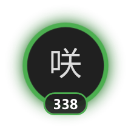
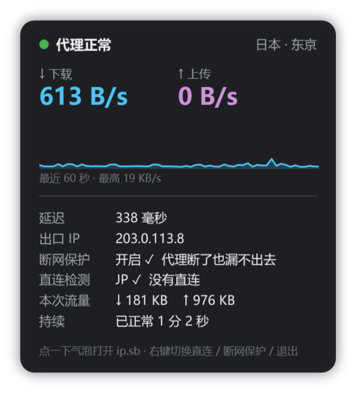

# 注意！！！
**本项目利用 Claude 辅助制作，已在作者电脑上测试通过，若仍不放心请斟酌使用！！！**

# v2rayN-auto-proxy
给 Windows 上的 [v2rayN](https://github.com/2dust/v2rayN) 配的一套小工具：**开机自动挂上代理**、**桌面状态气泡**、**代理掉线时的断网保护**，还有打游戏用的**直连模式**。

最初是为了解决一个很实际的担心：代理悄悄掉线以后，程序会直接用国内 IP 连上国外账号，可能触发风控甚至封号。所以它最核心的功能是：**代理一断，就用防火墙把直连全部拦住，并且立刻提醒你**。

<p align="center">
  
  &nbsp;&nbsp;&nbsp;
  
</p>

## 功能

- **开机自启**：登录后自动打开断网保护 → 启动 v2rayN → 等代理端口就绪 → 测几个国外网站，弹通知告诉你通没通
- **桌面气泡**：外圈颜色一眼看出代理状态，底部显示延迟；鼠标悬停弹出面板（网速、最近 60 秒曲线、两种延迟、出口 IP 和位置、断网保护状态、本次流量）
- **两种延迟**：「新建连接」是从握手开始访问一次网站的时间（打开新网站时的感觉，也用来判断掉线）；「复用连接」是连接建好以后一个来回的时间（看视频、聊天时的感觉，跟 v2rayN 列表里的延迟接近）。新建连接要走四五个来回，所以通常是复用连接的好几倍，这是正常的
- **数据直接读 v2rayN**：延迟优先用 sing-box 自己测的结果（sing-box 没在跑时才自己通过代理测），网速读 xray 的流量统计；端口从 v2rayN 的设置里自动算
- **掉线提醒**：进程没了、TUN 网卡没了、连续测不通，几秒内就弹通知；断网保护关着的时候掉线，会**响铃并一直停在屏幕上**
- **断网保护（kill switch）**：Windows 防火墙出站默认拦截，只放行 TUN、局域网和 v2rayN 自己。代理一断，其他程序都连不出去
- **直连检测**：每 20 秒问一次 Cloudflare"我从哪个国家来"，一旦看到 CN 就报警
- **直连模式（打游戏）**：右键气泡一键切换，游戏走你自己的网络，延迟更低。名单里的程序（浏览器、AI 客户端……）有两档可选（`config.ps1` 里的 `$DirectProxyApps`）：
  - **默认（最严格）**：切之前必须全部关掉，直连期间防火墙封锁它们，误打开了也连不上网
  - **名单程序走代理**：不用关，浏览器照常能用、照常走代理；v2rayN 只是关掉 TUN（这样游戏就不经过代理了）。名单程序被防火墙禁止直连外网，只能连本机的代理，代理断了它们就断网，不会漏出中国 IP。代价是名单里不走系统代理、也没设代理环境变量（`HTTPS_PROXY`）的程序，直连期间会连不上网

  重启电脑会自动切回代理模式

## 气泡颜色

| 外圈 | 底部 | 意思 |
|---|---|---|
| 🟢 绿 | 延迟数字（新建连接） | 正常（< 500 毫秒） |
| 🟡 黄 | 延迟数字 / `?` | 有点慢（500~1500 毫秒）/ 刚才测失败了一次 |
| 🔴 红 | 延迟数字 | 很慢（> 1500 毫秒） |
| 🔴 红 + 呼吸闪烁 | `×` | 掉线了 |
| 🔴 红 + 呼吸闪烁 | `CN` | 检测到有流量在用中国 IP 直连 |
| 🔵 蓝 | `直连` | 直连模式 |
| ⚪ 灰 | `...` | 检测中 |
| 外圈变成**虚线** | | 断网保护关着 |

- **单击**气泡：打开 ip.sb 看出口 IP
- **按住拖动**：随便放到屏幕哪里
- **右键**：切换直连模式 / 临时开关断网保护 / 退出

## 需要什么

- Windows 10（1903 以后）或 Windows 11
- v2rayN 7.x（在 7.19.5 上测试过），**建议打开 TUN 模式**
- 系统自带的 Windows PowerShell 5.1 就行，不用装别的

> 不开 TUN 也能用，但只有走系统代理的程序才会走代理；断网保护开着的话，其他程序都会被拦下连不了网，直连检测也会自动跳过。

## 安装

1. 到右边的 **Releases** 下载最新版本的 **Source code (zip)**，解压到一个**以后不会挪动**的地方，比如 `D:\Tools\auto-proxy`
2. 右键「开始」按钮 →「终端(管理员)」
3. 运行（路径换成你解压的位置）：

   ```powershell
   cd D:\Tools\auto-proxy
   powershell -ExecutionPolicy Bypass -File .\install.ps1
   ```

安装脚本会自动找到 v2rayN（找不到会问你），问你要不要开机自动开启断网保护，然后注册计划任务并马上启动。右下角出现气泡就是装好了。

## 更新

有新版本时，气泡会弹通知提醒你，右键菜单里也会多出一项「⬆ 查看新版本」，面板最底下的版本号会变成黄色。**它只提醒，不会自动下载安装**：先看看新版本改了什么，再决定要不要更新。

更新步骤：

1. 右键气泡 →「查看新版本」（或者直接打开 Releases 页面），下载新版本的 **Source code (zip)**
2. 解压后**覆盖**到原来的文件夹（你的 `config.ps1`、名单、头像不在压缩包里，不会被覆盖）
3. 管理员终端里再运行一次 `install.ps1`。它会沿用之前的设置，不再提问，并且自动重启气泡

想知道自己装的是哪个版本：鼠标移到气泡上，面板最底下一行就是。

## 自定义

| 想改什么 | 怎么改 |
|---|---|
| 气泡头像 | 把一张图片命名为 `avatar.png`（或 `avatar.jpg`）放进文件夹，下次启动气泡生效；没有头像时显示一个"咲"字 |
| 直连模式要封锁哪些程序 | 编辑 `sensitive-apps.txt`（安装时从 `sensitive-apps.example.txt` 复制出来的，里面有写法说明） |
| v2rayN 的位置、开机要不要自动开断网保护、要不要检查更新、直连时名单程序要不要走代理 | 编辑 `config.ps1`（安装时生成的），改完重新运行一次 `install.ps1`；也可以 `install.ps1 -Reconfigure` 重新回答安装时的问题 |
| 气泡大小、面板宽度 | `bubble.ps1` 开头的"外观参数" |

## ⚠ 上不了网了怎么办

断网保护的作用就是"代理不通就断网"。如果代理没问题却上不了网，或者你挪动/删除了 v2rayN 的文件夹，先**临时关掉断网保护**：

- 右键气泡 →「断网保护：开启中 ✓（点击临时关闭）」
- 气泡也打不开的话：管理员终端里运行

  ```powershell
  Set-NetFirewallProfile -Profile Domain,Private,Public -DefaultOutboundAction Allow
  ```

挪了 v2rayN 的位置以后，重新运行一次 `install.ps1` 就好。

另外，有些安全软件（比如 360、火绒）会接管 Windows 防火墙，这时断网保护可能不生效，或者被它们改回去。

## 卸载

管理员终端里运行：

```powershell
cd D:\Tools\auto-proxy
powershell -ExecutionPolicy Bypass -File .\uninstall.ps1
```

它会关掉气泡、删掉计划任务、把防火墙出站改回默认放行、删掉本工具建的防火墙规则。v2rayN 本身不受影响。之后可以直接删掉文件夹。

## 原理

### 断网保护

```
平时：程序 ──> TUN 网卡 ──> sing-box/xray ──> 节点        ✓ 放行（TUN 的地址段 172.18.0.0/30）
      v2rayN / xray / sing-box ──> 节点                  ✓ 放行（按程序路径）
      程序 ──> 路由器、局域网设备                           ✓ 放行（LocalSubnet）
      连上 Wi-Fi 后找路由器要 IP 地址（DHCP）               ✓ 放行（UDP 68→67、546→547）

掉线：程序 ──> Wi-Fi 网卡 ──> 国外网站（用的是国内 IP）     ✗ 出站默认拦截
```

本机内部的 `127.0.0.1` 不受防火墙管，所以走系统代理的程序也不受影响。

### 为什么用计划任务

v2rayN 开 TUN、改防火墙都需要管理员权限。开机启动项没法"以管理员身份运行"，而计划任务可以设置"以最高权限运行"，开机时不会弹 UAC。气泡本身只用普通权限，需要改防火墙时，它通过启动对应的计划任务来完成。

### 文件

| 文件 | 作用 |
|---|---|
| `install.ps1` / `uninstall.ps1` | 安装 / 卸载 |
| `auto-proxy.ps1` | 开机：开断网保护 → 启动 v2rayN → 等端口 → 测网 → 弹通知 |
| `bubble.ps1` | 桌面气泡（WPF） |
| `killswitch.ps1` | 断网保护开关：`-Mode On / Off / Status` |
| `mode.ps1` | 代理模式 ⇄ 直连模式 |
| `common.ps1` | 共用的设置和函数：读配置、算端口、弹通知 |
| `sensitive-apps.example.txt` | 直连模式封锁名单的模板 |

## 声明

这是个人兴趣写的小工具，按原样提供。断网保护能大幅降低意外直连的风险，但不能保证百分之百。请遵守你所在地的法律法规。

## License

[MIT](LICENSE)
